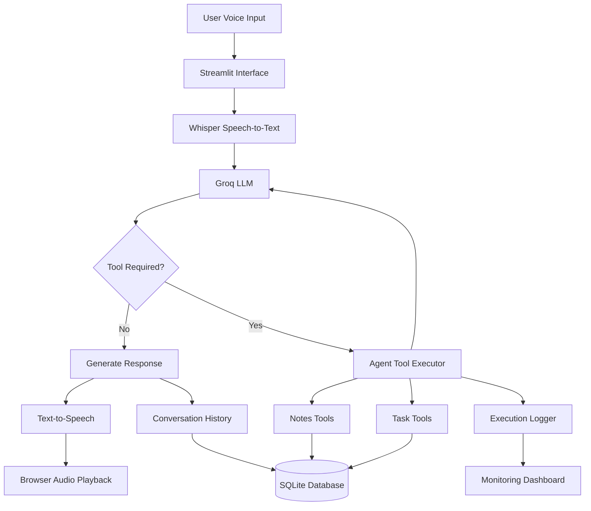

# 🎙️ Agentic AI Voice Assistant

An AI-powered personal voice assistant built with Python,
Groq, Whisper, Streamlit, and SQLite.

The application supports natural language conversations,
voice input and output, persistent conversation memory,
and agentic tool execution for managing notes and tasks.

## 🚀 Key Features

- 🎤 Voice input through a browser microphone
- 📝 Speech-to-text using Whisper
- 🧠 LLM responses using Groq
- 🔊 Text-to-speech audio playback
- 💬 Multi-turn conversational memory
- 🗄️ Persistent SQLite storage
- 🤖 AI function calling and multi-step tool execution
- 📝 Personal Notes Agent
- ✅ Task Management Agent
- 📊 Task and Notes Dashboards
- 📈 Agent execution logging and monitoring
- 🧪 Automated testing with Pytest
- 🔄 Continuous integration with GitHub Actions


## 📸 Application Screenshots

### AI Voice Assistant


### Task Management Dashboard


### Notes Management Dashboard


### Agent Monitoring Dashboard


## 🏗️ System Architecture



## 🛠️ Technology Stack

| Layer | Technology |
|---|---|
| Programming Language | Python 3.12 |
| User Interface | Streamlit |
| LLM Inference | Groq API |
| Language Model | GPT-OSS 20B |
| Speech Recognition | Whisper Large V3 Turbo |
| Text-to-Speech | pyttsx3 |
| Database | SQLite |
| Agent Orchestration | Custom Python Tool-Calling Loop |
| Data Analytics | Pandas |
| Testing | Pytest |
| CI | GitHub Actions |
| Logging | Python Logging |

## 🤖 Agentic AI Capabilities

The application provides two AI-powered agents.

### 1. Notes Agent

Supports:
- Saving personal notes
- Retrieving saved notes
- Viewing notes through Streamlit

Example voice command:

"Save a note that I need to practice Python tomorrow."

The agent identifies the requested operation and executes
the appropriate Python tool.

### 2. Task Management Agent

Supports:
- Creating tasks
- Retrieving pending tasks
- Viewing completed tasks
- Marking tasks as completed

Example voice command:

"Find my Python project task and mark it as completed."

The agent can retrieve the task list, identify a matching
task, and perform another tool call to complete it.

## 🧠 Multi-Step Agent Execution

The assistant implements a bounded tool-calling loop.

1. Receive a user request.
2. Send the request to the LLM.
3. Identify whether a tool is required.
4. Execute the selected Python tool.
5. Return the tool result to the LLM.
6. Continue if another tool is required.
7. Generate the final response.

The loop limits tool-calling rounds to reduce the risk
of uncontrolled execution.

## 🗄️ Persistent Memory

SQLite stores:

- Conversation history
- Personal notes
- Task information
- Task completion status

Conversation history can be restored after restarting
the application.

For the current local prototype, the database is
designed for a single user.

## 📊 Agent Observability

The application records execution metadata such as:

- Tool name
- Success or failure status
- Execution duration
- Timestamp

The Streamlit monitoring dashboard displays:

- Total tool executions
- Success rate
- Failed executions
- Average tool duration
- Tool usage charts
- Recent execution history

Logs exclude note contents and task descriptions.

## 📁 Project Structure

```text
AI-Voice Agent/
├── .github/
│   └── workflows/
│       └── python-tests.yml
├── tests/
│   ├── conftest.py
│   ├── test_database.py
│   └── test_agent_tools.py
├── app.py
├── voice_ai.py
├── database.py
├── agent_tools.py
├── agent_logger.py
├── log_reader.py
├── requirements.txt
├── .gitignore
└── README.md
```

## ⚙️ Local Setup

### Prerequisites

- Python 3.12
- VS Code or another Python editor
- Microphone and speakers
- Groq API key
- Windows for local pyttsx3 speech playback

### 1. Clone the repository

```bash
git clone https://github.com/Shoaib551999/-ai-voice-assistant-agent.git
cd -ai-voice-assistant-agent
```

### 2. Create a virtual environment

Windows PowerShell:

```powershell
python -m venv .venv
.\.venv\Scripts\Activate.ps1
```

### 3. Install dependencies

```bash
python -m pip install -r requirements.txt
```

### 4. Configure the API key

Create a `.env` file in the project root:

```env
GROQ_API_KEY=your_groq_api_key_here
```

Never commit API keys or local database files.

### 5. Start the application

```bash
python -m streamlit run app.py
```

Open:

http://localhost:8501

## 🧪 Automated Testing

The project includes automated tests for:

- SQLite conversation operations
- Notes creation and retrieval
- Task creation and completion
- Agent tool execution
- Invalid input handling

Run locally:

```bash
python -m pytest tests/ -v
```

Current local test suite: 14 passing tests.

GitHub Actions runs the automated test suite on pushes
and pull requests to the main branch.

## 🔐 Security Considerations

- API credentials are loaded through environment variables.
- SQLite operations use parameterized queries.
- Tool execution is limited to registered functions.
- Tool arguments are validated before execution.
- Execution logs avoid recording sensitive note contents.
- The agent loop has a maximum iteration limit.

This is a local portfolio prototype, not a security-audited
multi-user production service.

## ⚠️ Current Limitations

- Single-user local database
- Browser audio playback is manually initiated
- Local Windows text-to-speech engine
- API access subject to Groq rate limits
- Full conversation history is not sent indefinitely
- No user authentication
- CI currently focuses on database and tool tests
- No production deployment configured

## 🔮 Future Improvements

- FastAPI backend
- Streaming speech recognition
- Voice activity detection
- Natural voice synthesis
- User authentication
- Semantic memory retrieval
- Multi-user database support
- Stronger tool execution safety
- Docker deployment
- Expanded integration tests

## 🎯 Project Objective

Demonstrate practical AI engineering capabilities,
including speech processing, LLM integration,
agentic function calling, persistent memory,
tool execution, observability, and automated testing.

## 👨‍💻 Author

Shoaib

AI Engineering | Machine Learning | Agentic AI

GitHub:
https://github.com/Shoaib551999
